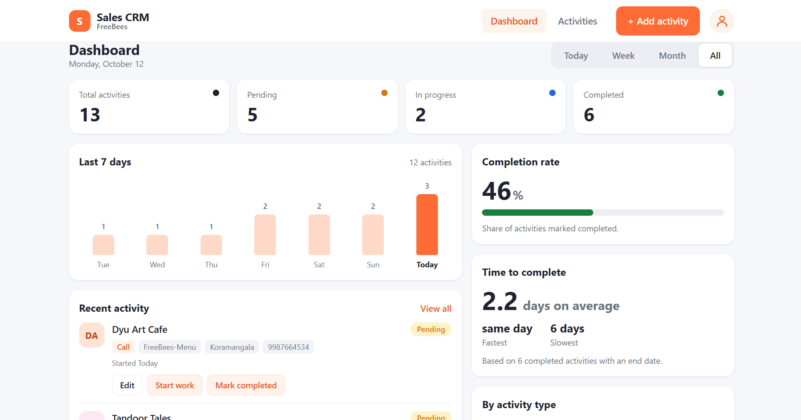
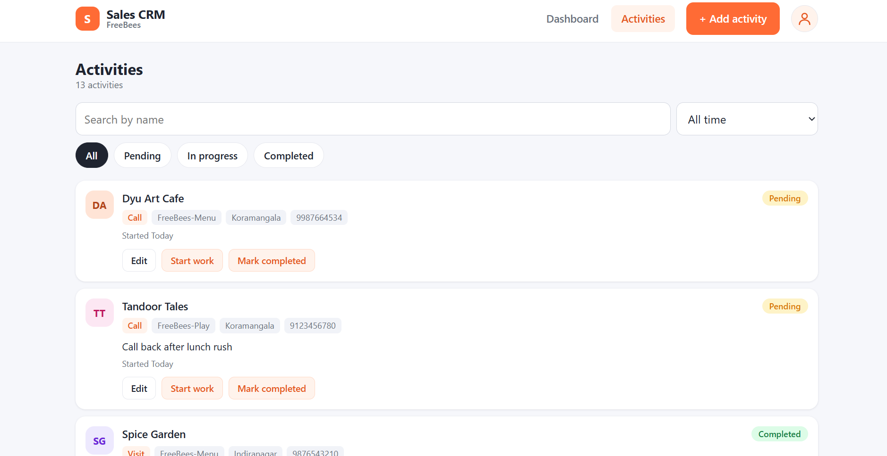
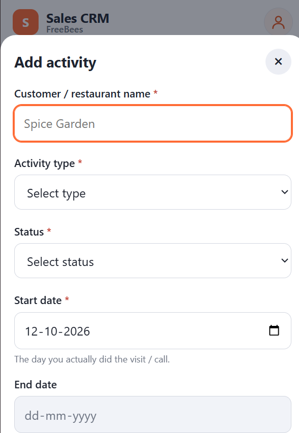

# Sales CRM – FreeBees

A simple, mobile-friendly Sales CRM for recording and tracking daily sales activities related to restaurant customers.

The application includes a dashboard, activity management form, REST API, and database integration.



| Activities                                     | Add / Edit Form                                  |
| ---------------------------------------------- | ------------------------------------------------ |
|  |  |

## Features

* Dashboard with activity counts, completion rate, charts, and recent activities.
* Add, view, and edit sales activities.
* Search by customer name and filter by status or date period.
* Track Calls, Visits, Demos, and Follow-ups.
* Record start dates, notes, and optional contact details, location, product interest, and end dates.
* Validate inputs on both the frontend and backend.
* Enforce activity status and date rules on the server.
* Responsive layout for desktop and mobile.
* Automated API tests using pytest.

## Tech Stack

| Layer              | Technology            |
| ------------------ | --------------------- |
| Frontend           | HTML, CSS, JavaScript |
| Backend            | Python, FastAPI       |
| ORM and validation | SQLAlchemy, Pydantic  |
| Database           | SQLite                |

## Getting Started

### 1. Clone the repository

```bash
git clone https://github.com/zehrahshameer07/sales-crm.git
cd sales-crm
```

### 2. Create and activate a virtual environment

```bash
python -m venv venv
```

On Windows PowerShell:

```powershell
venv\Scripts\Activate.ps1
```

On macOS/Linux:

```bash
source venv/bin/activate
```

### 3. Install dependencies

```bash
pip install -r requirements.txt
```

### 4. Run the application

```bash
uvicorn app.main:app --reload
```

Open the application at http://127.0.0.1:8000.

The SQLite database and tables are created automatically when the application starts. To add sample activities, run `python seed.py` in a separate terminal with the virtual environment activated.

### 5. Run the tests

```bash
pytest
```

Interactive API documentation is available at http://127.0.0.1:8000/docs.

## API Endpoints

| Method | Endpoint               | Purpose                        |
| ------ | ---------------------- | ------------------------------ |
| POST   | `/api/activities`      | Create an activity             |
| GET    | `/api/activities`      | Retrieve and filter activities |
| PATCH  | `/api/activities/{id}` | Edit an activity               |
| GET    | `/api/stats`           | Retrieve dashboard statistics  |

## Business Rules

* Activity status progresses from Pending to In Progress to Completed.
* Completed activities cannot be reopened.
* Start dates can be backdated but cannot be in the future.
* End dates are optional and apply only to completed activities.
* The server validates inputs and enforces business rules.

## Project Structure

```text
sales-crm/
├── app/
│   ├── main.py
│   ├── crud.py
│   ├── models.py
│   ├── schemas.py
│   └── database.py
├── static/
├── tests/
├── docs/
│   ├── schema.sql
│   └── screenshots/
├── seed.py
├── requirements.txt
└── README.md
```

## Database Schema

The application uses SQLite. The SQL schema is available in [`docs/schema.sql`](docs/schema.sql).

The `activities` table stores the customer name, activity type, status, contact details, location, product interest, notes, start date, end date, and record creation time.

## Implementation Approach

* **Layered backend:** API routes, database operations, models, and validation schemas are separated into modules.
* **Server-side validation:** Business rules are enforced by the backend rather than relying only on the frontend.
* **Database-driven dashboard:** Statistics are provided through the dashboard API.
* **Single application:** FastAPI serves both the API and frontend, so no separate frontend build step is required.
* **Safer rendering:** User-provided text is rendered using `textContent` rather than `innerHTML`.

## Scope and Limitations

This version focuses on activity management, dashboard statistics, API functionality, and database integration.

It does not currently include authentication or separate admin and salesperson accounts. The profile and logout controls are demonstration-only.

## Future Improvements

* Authentication and role-based access.
* Assign activities to individual salespeople.
* Follow-up reminders, reports, and CSV export.
* Pagination and database migrations.
