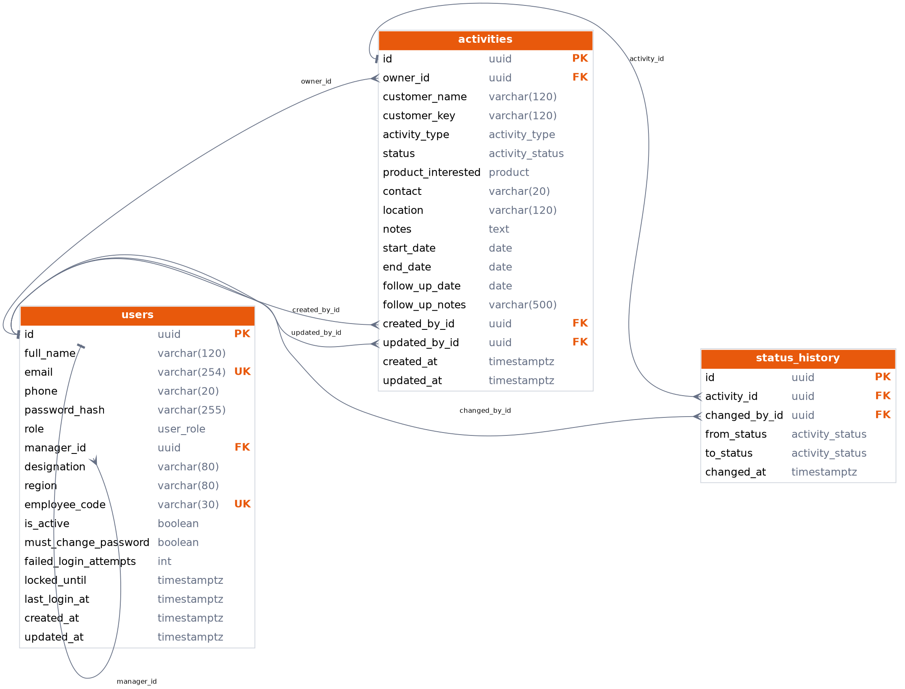
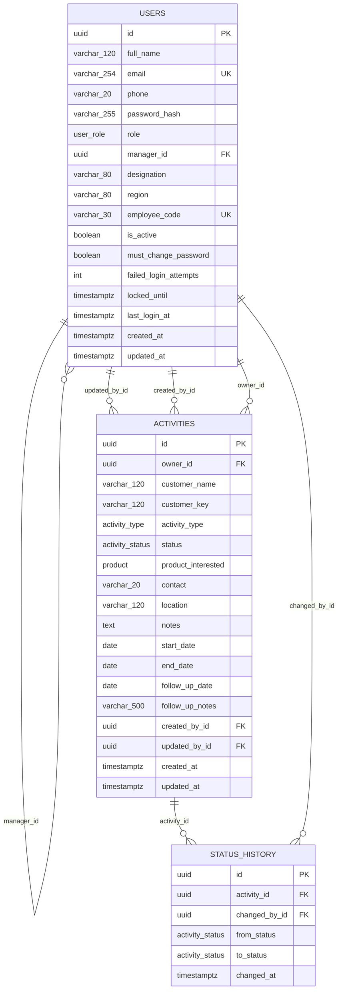

# Database diagram

Generated from the SQLAlchemy models by `python scripts/make_er_diagram.py`, so it always matches the code.

## Interactive version 

## Reading the diagram

- **users**: every employee. `manager_id` points to another user (who they report to).
- **activities**: one row per sales activity. `owner_id` is the salesperson it belongs to.
- **status_history**: audit trail of every status change (who, from, to, when).
- All IDs are UUIDs, so they can't be guessed or used to count records.
- Enums are real database enum types: `user_role`, `activity_type`, `activity_status`, `product`.
- A unique rule on (owner, customer, type, start date) prevents duplicate activities.
